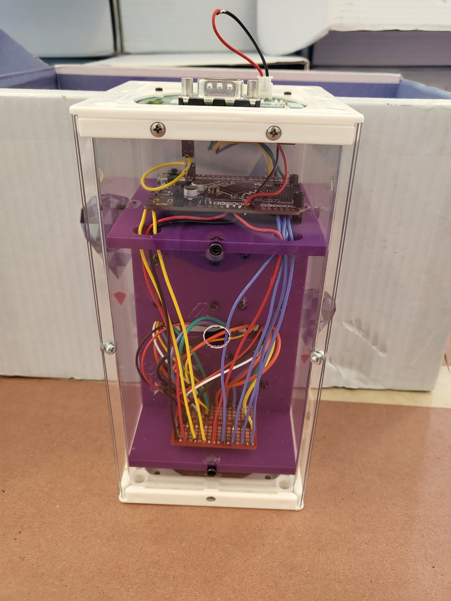
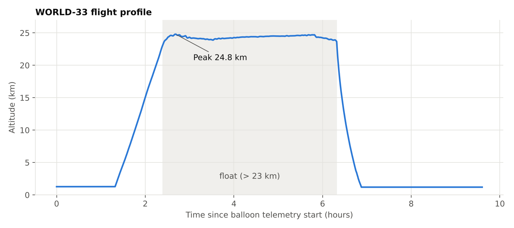

# WORLD-33: High-Altitude Balloon Experiment (NASA TechRise 2023–24)

Team **WORLD-33** from the Montgomery High School Aerospace Club was selected for the [NASA TechRise Student Challenge](https://www.futureengineers.org/nasatechrise) (2023–24). We designed and built a sensor payload that flew on a World View stratospheric balloon to **24.8 km (about 81,000 ft)**. It measured ozone, CO₂, NO₂, UV, ambient light, humidity and temperature for the whole 9.6-hour flight.

**Research question:** Which combination of ozone, CO₂ and NO₂ most effectively absorbs UV radiation in the atmosphere?

  
  

## What's in this repository

| Folder | Contents |
|---|---|
| [`proposal/`](proposal/) | Our proposal typeset in LaTeX (PDF and source), the original as submitted, and a text version |
| [`hardware/`](hardware/) | Bill of materials, wiring diagrams, budget and power checks |
| [`code/`](code/) | CircuitPython flight code, the modified telemetry library, and component tests |
| [`results/`](results/) | Raw flight data (CSV), charts, our 2024 post-flight analysis and its original graphs, and notes from re-reading the data |
| [`media/`](media/) | Payload photos and showcase slides |
| [`scripts/`](scripts/) | Python script that regenerates every chart from the raw data |

## The payload

| Part | Role |
|---|---|
| Adafruit Metro M4 Express | Flight computer (CircuitPython) |
| Ozone, CO₂, NO₂ sensors | Gas concentrations |
| UV / ambient-light sensor | UV exposure |
| MicroSD breakout | Data logging |
| TechRise Payload Interface Board | Power and balloon telemetry (altitude, GPS, pressure, temperature) |

The electronics mount on a 3D-printed insert inside the TechRise flight box. Details are in [`hardware/`](hardware/).

## Results at a glance

- The payload logged **6,196 rows of data** from the pad, through ascent and about 3.9 hours of float above 23 km, to landing about 200 km west of the launch site near Page, Arizona.
- In 2024 we reported that UV readings fall as ozone concentration rises, which is what we expected. We also concluded that the experiment couldn't isolate the effect of gas composition on UV.
- Re-reading the data in 2026 turned up why: the CO₂ sensor stopped reporting above about 10 km, the ozone values are most likely ppb rather than ppm, and every variable is confounded by altitude. The [results page](results/) covers all of it.

## Project timeline

| When | Milestone |
|---|---|
| Dec 2023 | Proposal submitted |
| Early 2024 | Component selection, ordering, soldering practice |
| Mar–Apr 2024 | SD-card and sensor tests, electronics prototype, flight code |
| May 2024 | Payload mounted, final testing, TechRise showcase |
| 2024 | Flight on a World View stratospheric balloon, then post-flight analysis |

## Team

Sri Undavalli, Jerry Qiu, Anant Grover, Aayush Aggarwal, Chaitanya Ballari, Pranav Rao, Ranvir Singh, Karthik Pakanati
Team lead teacher: Mr. Lee

## Acknowledgments

- **NASA TechRise Student Challenge**, run by [Future Engineers](https://www.futureengineers.org/) with NASA's Flight Opportunities program, for the flight, mentorship and starter hardware
- **World View** for the stratospheric balloon flight
- Future Engineers (Mark DeLoura and Arnie Martin) for the telemetry starter library our code builds on
- Adafruit for the SD-card example code

## License

- **Our code** (`code/flight/WORLD33_code.py`, `scripts/`): [MIT](LICENSE)
- **Documents, data, charts and photos:** [CC BY 4.0](LICENSE-docs.md)
- **Third-party code** keeps its original terms: the Future Engineers files in `code/` and the Adafruit example (MIT). See [`code/README.md`](code/README.md).

*This experiment was part of the NASA TechRise 2023–24 Challenge, funded and flight-tested by NASA's Flight Opportunities program. NASA has not independently verified or validated any data, results, or conclusions arising from this research. This is a student project and is not affiliated with or endorsed by NASA.*
