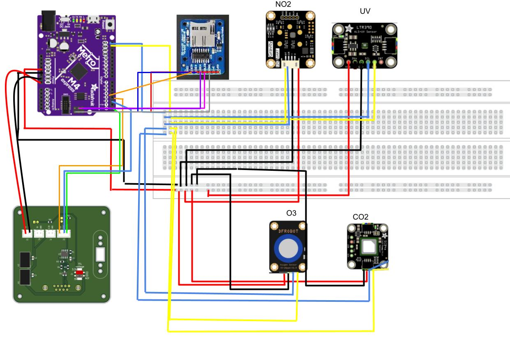
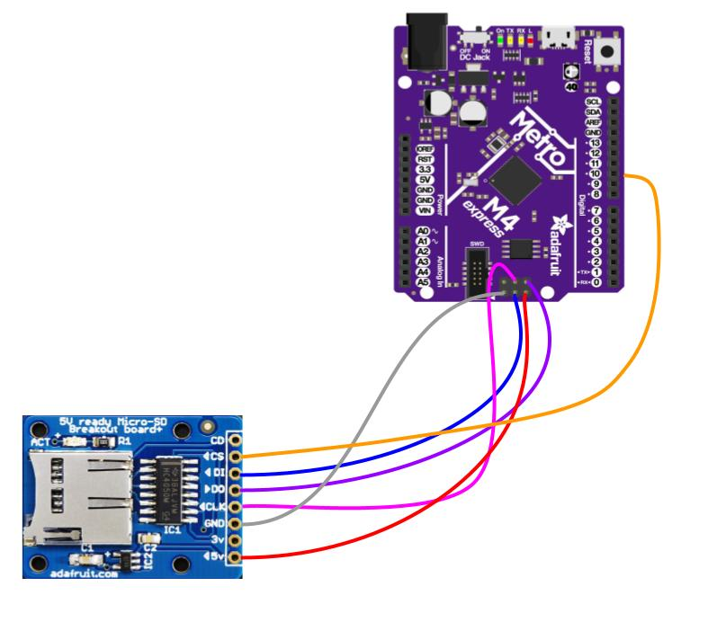

# Hardware

## Bill of materials (as flown)

| Component | Measures | Trigger | Mounting | Part |
|---|---|---|---|---|
| Adafruit Metro M4 Express | Flight computer; receives altitude, latitude, longitude from balloon telemetry | Power on | Standoffs and screws | [Adafruit 3382](https://www.adafruit.com/product/3382) |
| MicroSD breakout board | Data storage | 90 s after launch | Screws and nuts | [Adafruit 254](https://www.adafruit.com/product/254) |
| Ozone (O₃) sensor | Ozone concentration | Power on | Screws and nuts | [DFRobot Gravity I2C Ozone Sensor (0–10 ppm)](https://store-usa.arduino.cc/products/gravity-i2c-ozone-sensor-0-10ppm) |
| UV radiation sensor | UV index and ambient light | Power on | Screws and nuts | [Adafruit 4831](https://www.adafruit.com/product/4831) |
| CO₂ sensor | CO₂ concentration | Power on | Screws and nuts | [Adafruit 5190](https://www.adafruit.com/product/5190) |
| Nitrogen dioxide (NO₂) sensor | NO₂ concentration | Power on | Screws and nuts | [DFRobot](https://www.dfrobot.com/product-2515.html) |

The full spreadsheet, with the brainstorming, ordering and budget sheets, is in [`world33_bom.xlsx`](world33_bom.xlsx).

**Budget check against TechRise limits** (from the ordering sheet):
- Component mass: 59.8 g, against a 1,000 g limit
- Current draw: about 230 mA, against a 1,500 mA limit
- Parts spend, including spares: $473.55, against a $1,500 limit

A bench test before shipping measured **0.06 A at 9.04 V** at the PIB (see [`../media/payload/power_draw_test.jpg`](../media/payload/power_draw_test.jpg)).

## Wiring

| Electronics prototype (all sensors) | MicroSD breakout test |
|---|---|
|  |  |

## Mechanical

The sensors mount on a 3D-printed insert inside the TechRise flight box. The Metro M4 sits on the top deck, and the sensors are wired directly to it. Photos are in [`../media/payload/`](../media/payload/).
