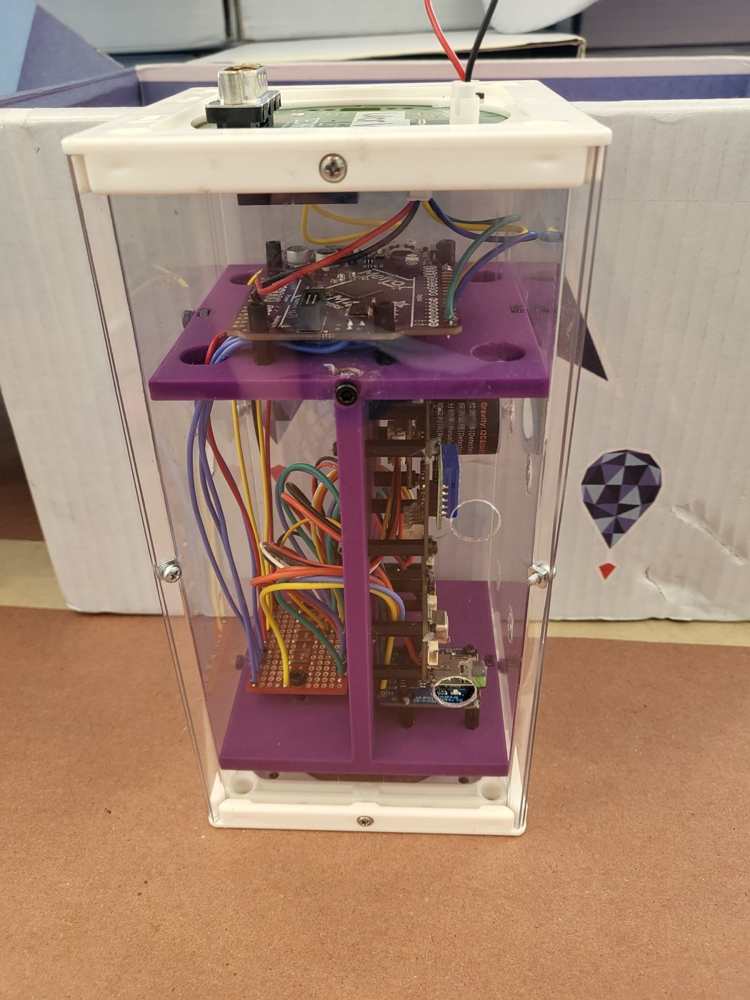
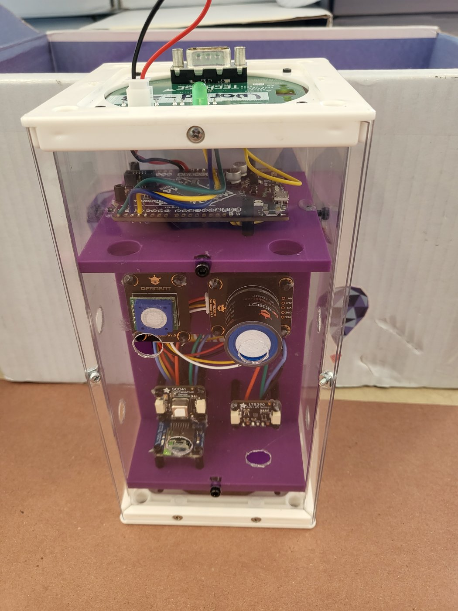
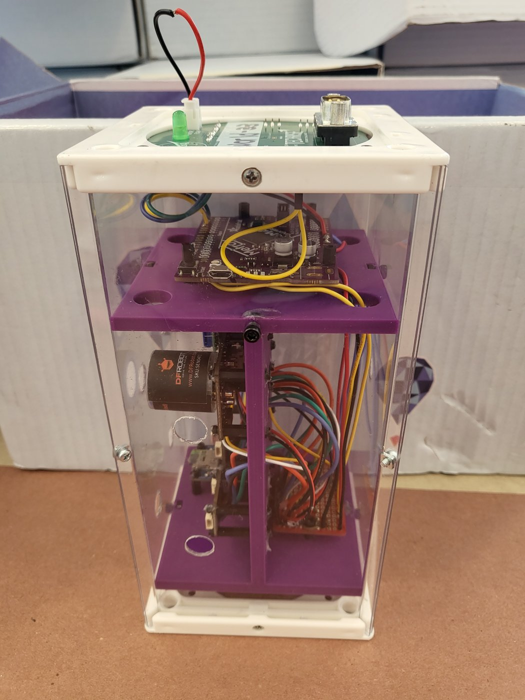
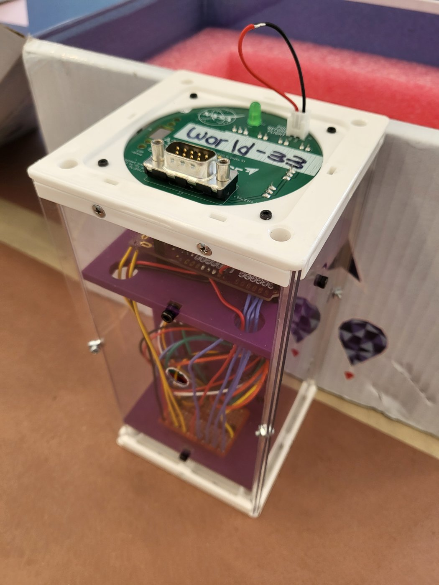
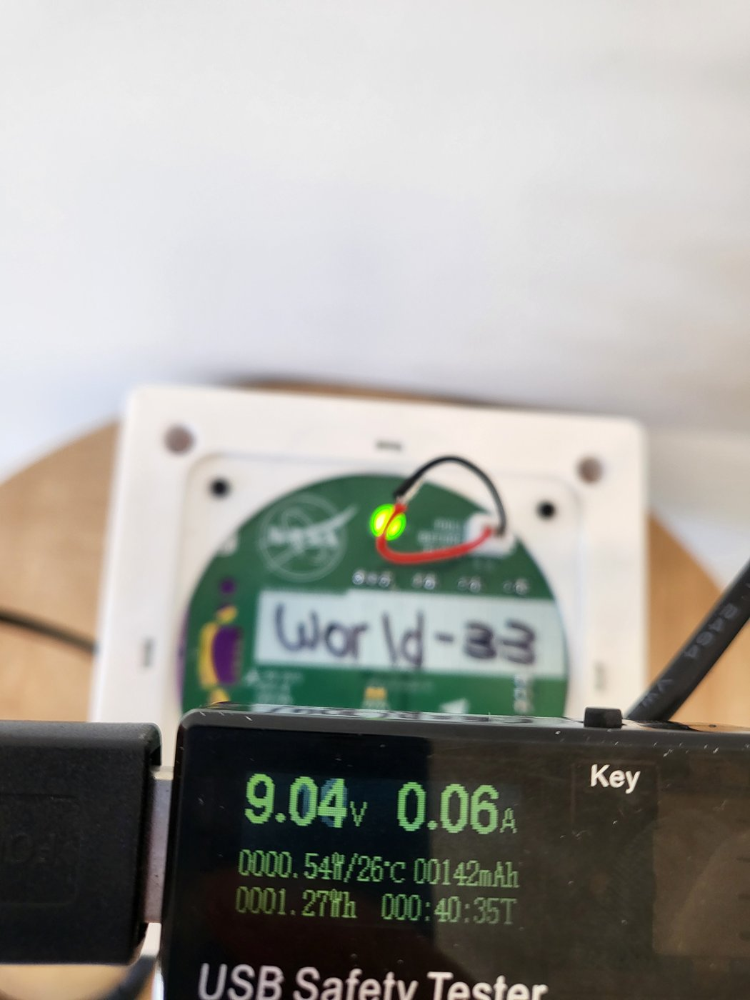

# Media

## Payload

| | | |
|---|---|---|
|  |  |  |
|  |  |  |

*The last photo is the pre-ship power check: 9.04 V, 0.06 A at the payload interface board.*

## Showcase

[`showcase_slides.pdf`](showcase_slides.pdf) contains the slides from our NASA TechRise Showcase presentation (May 2024).
