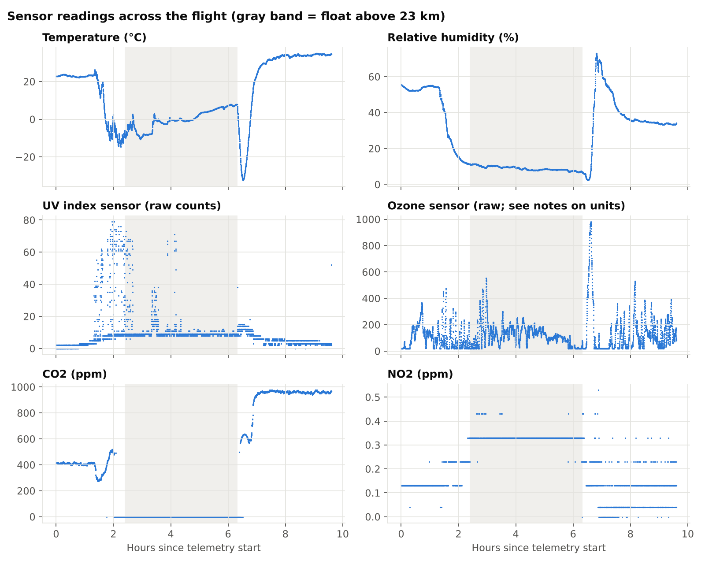
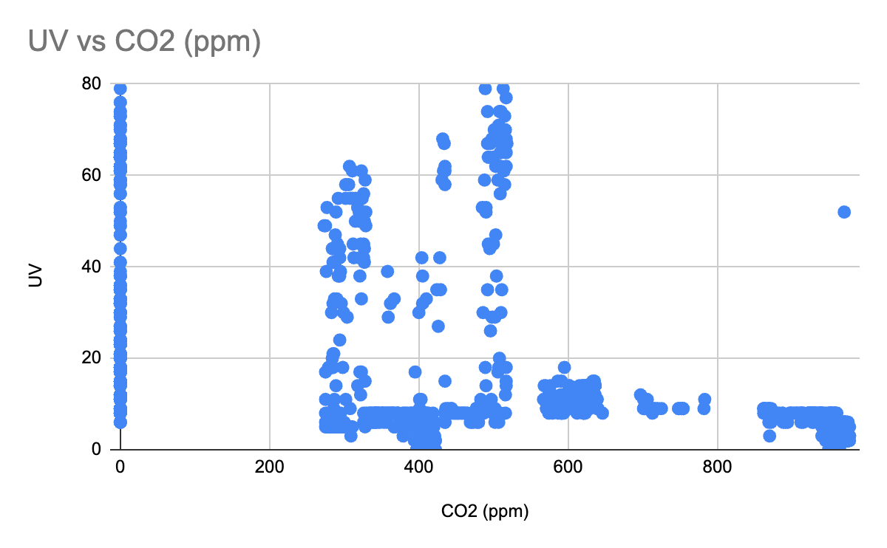
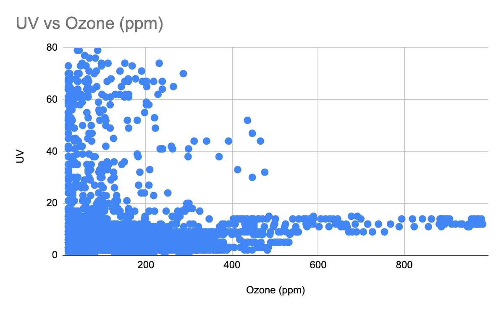
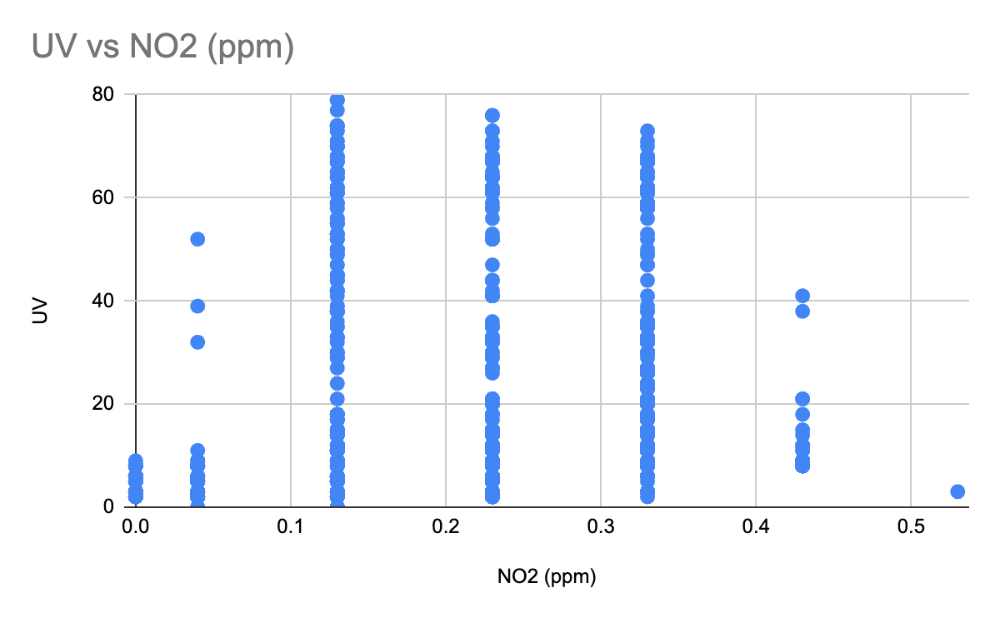
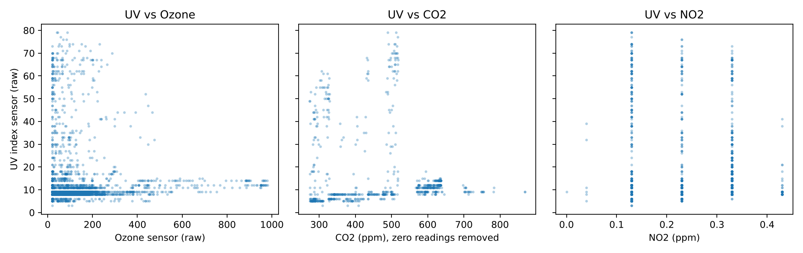

# Results

## Flight summary

| | |
|---|---|
| Launch site | Near Page, Arizona (36.93° N, 111.45° W, about 1,270 m elevation) |
| Peak altitude | **24,796 m** (about 81,350 ft) |
| Ascent | about 64 min from launch to 23 km |
| Float above 23 km | about 3.9 hours |
| Descent | about 32 min |
| Landing | about 200 km west of launch (36.93° N, 113.71° W) |
| Data logged | 6,196 rows, one every ~6 s, over 9.6 hours |




## Original post-flight analysis (2024)

Our team submitted this analysis to TechRise in 2024. It's reproduced word for word below; the original is [`post_flight_analysis_report.pdf`](post_flight_analysis_report.pdf).

**Experiment title:** UV Absorption of Different Gasses and Compositions

### Findings

> The goal of our experiment was to find any possible correlation between different gasses and their absorption of UV radiation. Our prediction was that the gasses with the highest densities will absorb more UV radiation than less dense gasses, in addition to the fact that some gasses may have more of an effect on it than others due to their nature. Our experiment yielded the expected result that more ozone particles results in greater UV absorption. At the same time we realized during our analysis that if there was a relationship between any of the components of the atmosphere and UV radiation, our graphs would reflect it as if the UV was getting affected by the measured gas whereas in reality it would be effected by something else entirely. We found a general trend between gasses and UV as the ppm of the gasses increased, the level of UVS suddenly decreased in the graph. When the ppm of the gas was near zero, the UVS where concentrated toward the higher spectrum of the graph. Overall, we were hoping to see a clear cut relationship between the gasses and the UV absorption but in fact a major flaw prevented us from observing one.

**Trends we reported** (our original 2024 graphs, made in Google Sheets):

| UV vs CO₂ | UV vs ozone | UV vs NO₂ |
|---|---|---|
|  |  |  |

- **CO₂:** As CO₂ concentration increases, UV follows a decreasing trend.
- **Ozone:** As ozone concentration increases, UV follows a decreasing trend, which supports the idea that higher ozone concentrations reduce UV radiation.
- **NO₂:** UV doesn't change with NO₂ concentration in any pattern, which suggests NO₂ doesn't affect UV radiation.

### Reflection

> If we had to redo the experiment, we would change certain elements of our process in order to allow for a data collection that can be analyzed. After reflection, we found the original hypothesis very shaky and not precise. What we mean by that is that we should have accounted for problems that could potentially come up during data analysis based on our data collection. Generally we should have done more research beforehand. Since we didn't, it led to a disorganized structure of the experiment. We were not able to detect the percentage composition of the gasses, but rather the individual concentrations of the gasses. Instead, we should have adapted our hypothesis throughout the experiment according to our available materials. This was effectively a testing experiment to see whether UV radiation was truly absorbed by ozone particles.
>
> We are definitely excited to create a new experiment to submit to the techrise challenge again. Our team is even more eager to create another project due to the experience we have gathered from our current experiment. We plan to come up with a more meaningful and thorough experiment. Additionally, we will also be able to work on it more efficiently owing to the fact that we have gained a basic understanding of certain skills such as soldering that were necessary but took a long time to learn. This way we can focus more on the end goal rather than the skills needed to get there, although we are well aware that different skills are required for different projects. Overall we feel more inclined to work on another project as a result of our experience from this current one which has piqued our interest in this type of student-led project.

## Notes on the data (added 2026)

Going back through the raw data turned up several things that the 2024 analysis didn't account for. The charts on this page take them into account.

1. **Correlation is not causation, and altitude is the confounder.** UV, gas readings, temperature and humidity all change with altitude and time of day. A UV-vs-gas scatter plot can show a trend even if the gas has no effect on UV. Our 2024 reflection already pointed at this ("in reality it would be effected by something else entirely").
2. **The CO₂ sensor stopped reporting at altitude.** CO₂ reads exactly 0 for 2,837 rows, from about 9.8 km on ascent until early in the descent. That most likely means the sensor stopped returning valid readings at low pressure, not that there was zero CO₂ up there. Those zeros are the vertical stripe at CO₂ = 0 in the [2024 UV-vs-CO₂ chart](charts/2024/uv_vs_co2_2024.png), and they drive most of its apparent trend. The chart below removes them.
3. **The ozone values are most likely in ppb, not ppm.** The spreadsheet labeled the column "ppm", but the sensor's range is 0–10 ppm and the logged values run from 20 to 982. That fits ppb, which is the unit the DFRobot ozone library reports. The CSV keeps the raw values and calls the column `ozone_raw`.
4. **The NO₂ readings are coarse.** They take only seven values (0, 0.04, 0.13, … 0.53 ppm) because of the sensor's resolution. That's why the NO₂ scatter plot is vertical stripes.
5. **The ambient-light channel saturates.** ALS peaks at 65,535, the maximum of a 16-bit value, so the brightest readings are clipped.
6. **The readings after landing aren't clean outdoor air.** CO₂ rises to about 960 ppm and humidity jumps after touchdown, which suggests the payload was enclosed or handled during recovery.
7. **Minor gaps:** one telemetry packet arrived as all zeros (altitude, latitude and longitude = 0 at t = 23,112 s), and one row is missing its temperature. Both are left as-is in the CSV.



*UV against each gas, using only readings taken off the ground, with the invalid CO₂ zeros removed.*

## Data files

[`data/world33_flight_data.csv`](data/world33_flight_data.csv) holds every row the payload logged. The values are exactly as recorded; only the column names were cleaned up.

| Column | Original header | Description |
|---|---|---|
| `humidity_pct` | Humidity | Relative humidity (%) |
| `als_raw` | ALS | Ambient light, raw counts from the UV/light sensor (saturates at 65,535) |
| `ozone_raw` | Ozone (ppm) | Ozone sensor reading. Most likely ppb (see note 3) |
| `uvs_raw` | UVS | UV channel, raw counts from the UV/light sensor |
| `co2_ppm` | CO2 (ppm) | CO₂ concentration. 0 = invalid reading (see note 2) |
| `no2_ppm` | NO2 (ppm) | NO₂ concentration |
| `time_payload_s` | Time (s) (ours) | Seconds on our payload's clock |
| `time_balloon_s` | Time (s) (balloon) | Seconds since balloon telemetry started |
| `temperature_c` | Temperature (°C) | Temperature as logged |
| `altitude_m` | Altitude (m) | Altitude above sea level from balloon telemetry |
| `longitude_deg` | *(unlabeled)* | Longitude from balloon telemetry |
| `latitude_deg` | *(unlabeled)* | Latitude from balloon telemetry |

To regenerate the charts:

```bash
pip install pandas matplotlib
python scripts/make_charts.py
```

---

*This experiment was part of the NASA TechRise 2023–24 Challenge, funded and flight-tested by NASA's Flight Opportunities program. NASA has not independently verified or validated any data, results, or conclusions arising from this research, and expressly disclaims any liability or responsibility for the accuracy of the information or conclusions drawn here.*
